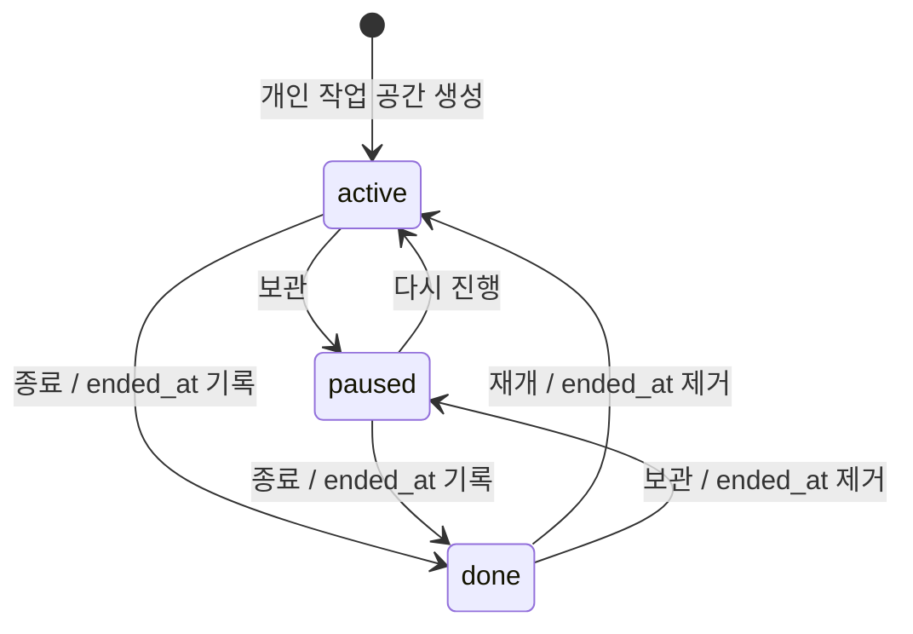
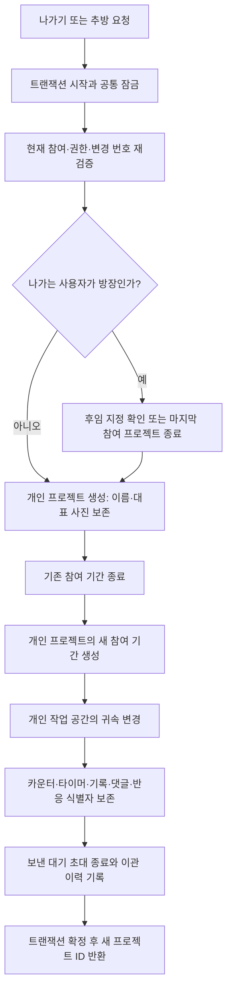

# 기능 요구사항 명세

기능 요구사항의 출처는 「뜨개로그 백엔드 기능정의서」 14쪽에 대한 기존 분석입니다. 분석에는 PDF 7·9·10쪽의 표와 관계도를 포함합니다.

기존 분석 기준: `feat/sdk-ci-prisma-skills` 브랜치의 `59c92ad` 커밋입니다. 이번 문서 갱신에서는 원본 PDF를 다시 확인하지 않았습니다. 기존 기능 ID와 원문 쪽을 유지합니다.

DB 표준의 출처는 2026-10-09 사용자 추가 요구사항입니다. 설계자는 이 표준을 테이블 설계와 DDL에 적용해야 합니다. 문서 갱신은 실제 DB 반영 승인을 뜻하지 않습니다. 로컬 스키마 갱신도 실제 DB 반영 승인을 뜻하지 않습니다.

구조 설계의 출처는 2026-10-10 사용자 승인 ERD 피드백입니다. 설계자는 개인 작업 공간 분리·이관 이력·복구 경계를 적용해야 합니다. 실제 DB 반영과 배포는 이 승인에 포함하지 않습니다.

정책 확정의 출처는 2026-10-10 사용자 지시입니다. 사용자는 미결 사항의 권장안을 확정 요구사항으로 선택했습니다. 6절은 그 결정의 기준입니다. 기존 PDF 분석과 충돌하면 이 결정을 우선해야 합니다. 7절은 사용자가 추가한 API 버저닝 요구사항입니다. 정책 확정은 구현이나 검증 완료를 뜻하지 않습니다.

작성 기준일은 2026-10-15입니다. 실행 모드는 `LOCAL_ONLY`입니다. 이 문서는 요구 동작과 수용 조건의 기준입니다.

**작성 규칙**

- [ASD-STE100 Issue 9](https://www.asd-ste100.org/assets/files/ASD-STE100_ISSUE9.pdf)의 명료성 원칙을 참고합니다.
- 한국어 문장은 짧게 작성합니다. 한 문장에는 하나의 요구 동작을 적습니다.
- 요구 문장은 행위자를 밝힙니다. 조건이 있으면 동작보다 먼저 적습니다.
- 필수 동작은 `해야 합니다`로 표시합니다. 금지 동작은 `하지 않아야 합니다`로 표시합니다.
- 표의 동작과 수용 기준에도 같은 의무를 적용합니다.
- ASD-STE100은 영어 표준입니다. 이 한국어 문서의 정식 표준 준수를 주장하지 않습니다.

**확정**은 PDF 또는 사용자 추가 요구사항으로 동작을 정한 상태입니다. 기능 추적표의 확정 상태는 구현 완료를 뜻하지 않습니다. 초기 버전에서 제외한 기능은 6절에 명시합니다. ID는 기능 추적 단위이며 별도 엔드포인트를 뜻하지 않습니다.

후속 사용자 결정은 해당 범위에서 기존 분석보다 우선합니다. 내 참여 이력의 처리 책임은 AccountController로 통합합니다. 향후 IaC는 Pulumi와 TypeScript를 사용합니다. 인프라 구성은 유예합니다.

사용자 추가 결정이 없는 항목에서 앱 코드와 PDF가 충돌하면 PDF를 기준으로 해야 합니다.

현재 반영 여부는 [구현 현황](implementation-status.md)에서 관리합니다. 실행 증거는 [검증 기록](implementation-validation.md)에서 관리합니다. 원문 재확인이 필요한 동작을 현재 코드만으로 확정하지 않습니다.

**용어**

| 용어 | 이 문서의 의미 |
|---|---|
| 계정 | 로그인과 사용자 식별의 단위입니다. 프로젝트 참여와 구분합니다. |
| 로그인 ID | 인증에 사용하는 고정 식별자입니다. 다른 사용자에게 공개하지 않습니다. |
| handle | 프로필에서 사용하는 변경 가능한 계정 ID입니다. 로그인 ID와 구분합니다. |
| 프로젝트 멤버십 | 사용자가 프로젝트에 참여한 기간입니다. 개인 작업 데이터의 소유 단위가 아닙니다. |
| 유효한 참여 | 현재 종료되지 않은 프로젝트 참여입니다. 삭제된 부모에 대한 접근을 허용하지 않습니다. |
| 개인 작업 공간 | 상태·실·바늘·카운터·타이머·작성 기록을 소유하는 사용자별 작업 단위입니다. |
| 이관 | 참여를 종료하고 개인 작업 공간을 다른 프로젝트로 옮기는 작업입니다. 기존 참여 이력은 보존합니다. |
| 역이관 | 원 이관 결과와 이후 변경을 확인한 뒤 승인된 귀속 변경을 수행하는 작업입니다. 과거 이력을 지우지 않습니다. |
| 논리삭제 | 행을 남기고 업무 조회와 변경에서 제외하는 처리입니다. |
| 물리삭제 | 보존 조건과 참조를 확인한 뒤 행 또는 파일을 실제로 제거하는 처리입니다. |
| 작업 식별자 | 명령의 중복 처리를 방지하는 식별자입니다. 같은 명령의 재시도에 재사용합니다. |
| 변경 번호 | 오래된 변경을 구분하는 `version` 값입니다. |
| 수용 기준 | 검증자가 성공·거부·실패 결과를 판정하는 조건입니다. |

## 공통 규칙

- 서버는 상태·실·바늘·카운터·타이머·기록을 사용자의 개인 작업 공간에 귀속시켜야 합니다.
- 작업 상태는 `active`, `paused`, `done`입니다.
- `done`으로 전환하면 서버는 `ended_at`을 기록해야 합니다.
- `done`에서 다른 상태로 전환하면 서버는 `ended_at`을 지워야 합니다.
- 사용자 간 조회에서 서버는 차단 여부를 먼저 확인해야 합니다.
- 공동 프로젝트 조회에서는 서버가 현재 프로젝트 참여 권한을 확인해야 합니다.
- 프로필 기록과 총 시간 조회에서는 서버가 프로필 공개 범위를 확인해야 합니다.
- 같은 프로젝트의 멤버는 프로필 공개 범위와 무관하게 해당 프로젝트의 진행상황과 기록을 조회할 수 있습니다.
- 차단된 상대의 데이터는 공동 프로젝트에서도 노출하지 않아야 합니다.
- 서버는 차단된 상대의 검색 결과·프로필·게시글·댓글·프로젝트 기록을 양방향으로 숨겨야 합니다.
- 서버는 숨긴 데이터를 목록·검색·집계에서도 제외해야 합니다.
- 서버는 피드 게시글의 노출에 프로필 공개 범위를 적용하지 않아야 합니다.
- 피드에서도 서버는 차단과 삭제 검사를 유지해야 합니다.
- 이관 시 서버는 다른 작성자의 댓글과 반응도 원 기록에 연결한 채 보존해야 합니다.

## 기능별 추적표

각 행은 원문 쪽과 기능 ID를 유지합니다. 입력 필드와 HTTP 계약은 [API 테스트 계약](api-test-contract.md)을 따릅니다. 메뉴와 화면 이동은 클라이언트 동작입니다. 해당 항목이 별도 API를 요구하지는 않습니다.

인증이 필요한 기능은 유효한 현재 인증을 확인해야 합니다. 대상 자원이 필요한 기능은 대상의 존재와 삭제 상태를 확인해야 합니다. 아래 표는 각 기능에 추가로 적용하는 조건을 적습니다. 검증자는 각 행의 성공 조건과 거부 조건을 함께 검사해야 합니다.

| ID | 원문 쪽 | 행위자·선행 조건 | 요구 동작 | 거부·제외 조건 | 수용 기준 | 결정 상태 |
|---|---:|---|---|---|---|---|
| V1-101 | 2 | 가입 사용자. 인증 불필요 | 서버는 고유한 로그인 ID를 생성해야 합니다. | 형식 위반 또는 사용 이력이 있는 ID | 정규화 후 중복을 거부합니다. 타인 조회 응답에 로그인 ID를 노출하지 않습니다. | 확정 |
| V1-102 | 2 | 가입 사용자. 인증 불필요 | 서버는 고유한 handle을 생성해야 합니다. | 형식 위반 또는 다른 계정의 사용 이력이 있는 handle | 현재 중복과 다른 계정의 과거 사용을 거부합니다. 가입 후 변경을 허용합니다. | 확정 |
| V1-103 | 2 | 가입 사용자. 인증 불필요 | 서버는 닉네임과 비밀번호로 계정을 생성해야 합니다. 생성 후 로그인 토큰을 발급해야 합니다. | 6.3절의 비밀번호 정책 위반 | 유효한 입력은 가입에 성공합니다. 흔한 비밀번호와 유출 비밀번호는 거부합니다. | 확정 |
| V1-104 | 2 | 가입 사용자. 인증 불필요 | 서버는 동의 시각과 정책 문서 버전을 저장해야 합니다. | 필요한 정책 동의 누락 | 저장한 동의가 정확한 문서 버전을 참조합니다. | 확정 |
| V1-105 | 2 | 로그인 요청 사용자. 인증 불필요 | 자격 증명이 일치하면 서버는 로그인 토큰을 발급해야 합니다. | 자격 증명 불일치 또는 시도 제한 초과 | 실패 응답은 계정 존재를 노출하지 않습니다. 탈퇴 계정은 로그인하지 못합니다. | 확정 |
| V1-106 | 2 | 유효한 갱신 세션 보유 사용자 | 서버는 토큰을 갱신해야 합니다. | 무효한 갱신 세션 | 유효한 세션만 갱신합니다. 무효화한 세션은 거부합니다. | 확정 |
| V1-107 | 2 | 유효한 일회용 복구 코드 보유 사용자 | 서버는 로그인 ID·코드·새 비밀번호로 비밀번호를 재설정해야 합니다. 코드를 교체해야 합니다. 기존 인증을 무효화해야 합니다. | 코드 불일치·재사용 또는 시도 제한 초과 | 코드 원문을 저장하지 않습니다. 동시 재사용과 과거 접근·갱신 토큰을 거부합니다. | 확정 |
| V1-108 | 2 | 정책 문서 조회 사용자. 인증 불필요 | 서버는 로그인 없이 정책 문서를 제공해야 합니다. | 인증 부재를 거부 사유로 사용하지 않음 | 6.3절의 효력 시각에 맞는 한국어 문서를 반환합니다. | 확정 |
| V1-109 | 2 | 로그인 사용자 | 서버는 로그아웃을 처리해야 합니다. | 유효하지 않은 인증 | 로그아웃한 세션의 인증을 거부합니다. | 확정 |
| V1-110 | 2 | 로그인 사용자 | 서버는 계정 탈퇴를 처리해야 합니다. | 다른 멤버가 있는 프로젝트의 방장 후임 미지정 | 인증을 즉시 차단합니다. 후임 처리 실패 시 탈퇴 전체를 롤백합니다. | 확정 |
| V1-201 | 2 | 로그인 사용자. 본인 프로필 | 서버는 공개 범위를 변경해야 합니다. 기본값은 `public`입니다. | `public`·`friends`·`private` 외의 값 | 각 공개 범위에 따라 기록 목록과 총 시간이 달라집니다. | 확정 |
| V1-202 | 2 | 로그인 사용자. 본인 계정 | 서버는 handle 변경을 허용해야 합니다. 로그인 ID는 변경하지 않아야 합니다. | 형식 위반 또는 다른 계정의 현재·과거 handle | 같은 계정의 과거 handle 복귀는 현재 고유성을 확인합니다. | 확정 |
| V1-203 | 2 | 로그인 사용자. 본인 프로필 | 서버는 소개를 변경해야 합니다. | 타인 프로필 변경 | 본인 소개만 변경됩니다. | 확정 |
| V1-204 | 2 | 로그인 사용자 | 서버는 본인의 통계를 제공해야 합니다. | 타인 통계를 본인 통계로 조회하는 요청 | 요청한 인증 주체의 통계를 반환합니다. | 확정 |
| V1-205 | 2 | 로그인 사용자 | 서버는 본인의 기록을 모아서 제공해야 합니다. | 타인 기록을 본인 기록으로 조회하는 요청 | 본인 기록을 반환합니다. 삭제된 부모 아래의 기록은 제외합니다. | 확정 |
| V1-206 | 2 | 로그인 사용자. 조회 가능한 프로필 | 서버는 프로필 기본 정보를 제공해야 합니다. | 차단 관계 | 차단된 상대의 프로필과 비공개 로그인 ID를 노출하지 않습니다. | 확정 |
| V1-207 | 2 | 로그인 사용자. 차단 관계 아님 | 서버는 대상 프로필의 공개 범위로 기록과 총 시간을 제한해야 합니다. | 공개 범위 미충족 또는 차단 관계 | 공동 프로젝트 참여만으로 프로필 전체를 노출하지 않습니다. 제한한 데이터는 목록·집계에서도 제외합니다. | 확정 |
| V1-208 | 2 | 로그인 사용자. 차단 관계 아님 | 서버는 프로필 공개 범위와 무관하게 대상 사용자의 게시글을 제공해야 합니다. | 차단 관계 또는 삭제된 게시글 | 비공개 프로필의 게시글은 조회됩니다. 차단된 상대의 게시글은 숨깁니다. | 확정 |
| V1-209 | 2 | 로그인 사용자. 조회 가능한 프로필 | 클라이언트는 프로필 메뉴를 제공해야 합니다. | 메뉴에서 실행한 기능의 권한 미충족 | 메뉴의 각 동작에 해당 기능의 권한과 차단 규칙을 적용합니다. | 확정 |
| V1-301 | 3 | 로그인 사용자 | 서버는 사용자를 검색해야 합니다. | 차단 관계의 사용자 노출 | 검색 결과에서 차단된 상대를 제외합니다. | 확정 |
| V1-302 | 3 | 로그인 사용자. 대상과 차단 관계 아님 | 서버는 친구 요청을 전송해야 합니다. 상대의 대기 요청이 있으면 친구로 전환해야 합니다. | 차단 관계 | 교차 요청 시 친구 관계를 생성합니다. 대기 요청을 중복으로 남기지 않습니다. | 확정 |
| V1-303 | 3 | 친구 요청을 받은 사용자 | 서버는 요청 수락 또는 거절을 처리해야 합니다. | 타인 요청 처리 또는 차단 관계 | 수락은 친구 관계로 전환합니다. 거절은 대기 상태를 종료합니다. | 확정 |
| V1-304 | 3 | 친구 요청을 보낸 사용자 | 서버는 보낸 요청을 취소해야 합니다. | 타인 요청 취소 | 본인의 대기 요청만 종료합니다. | 확정 |
| V1-305 | 3 | 로그인 사용자 | 서버는 친구 목록과 친구 해제를 제공해야 합니다. | 타인의 친구 관계 변경 | 목록에서 차단된 상대를 제외합니다. 해제 후 친구 전용 조회를 허용하지 않습니다. | 확정 |
| V1-306 | 3 | 로그인 사용자 | 서버는 친구 요청 배지에 필요한 정보를 제공해야 합니다. | 차단된 상대의 요청 포함 | 배지 정보에 현재 유효한 요청만 반영합니다. | 확정 |
| V1-401 | 4 | 로그인 사용자 | 서버는 방장 1명인 비공개 프로젝트를 생성해야 합니다. | 유효하지 않은 인증 | 생성자를 방장으로 둡니다. 프로젝트를 공개 프로젝트로 노출하지 않습니다. | 확정 |
| V1-402 | 4 | 프로젝트를 생성하거나 참여하는 사용자 | 서버는 프로젝트 참여와 개인 작업 공간을 구분해야 합니다. 작업 공간에 기본 카운터 2개를 생성해야 합니다. | 중복된 유효 참여 또는 중복 초기화 | 기본 카운터를 한 번 생성합니다. 재가입 시 새 참여 기간을 생성합니다. | 확정 |
| V1-403 | 4 | 프로젝트 생성 사용자. 초대 대상은 친구 | 서버는 프로젝트 생성과 친구 초대를 같은 트랜잭션으로 처리해야 합니다. | 초대 권한·친구·차단 조건 미충족 | 초대 처리 실패 시 프로젝트 생성도 롤백합니다. | 확정 |
| V1-404 | 4 | 로그인 사용자 | 서버는 사용자가 참여한 프로젝트 목록을 제공해야 합니다. | 유효한 조회 권한 부재 | 다른 사용자의 비공개 프로젝트를 노출하지 않습니다. | 확정 |
| V1-405 | 4 | 로그인 사용자. 본인 프로젝트 목록 | 서버는 작업 상태에 따른 정렬과 필터를 제공해야 합니다. | 유효한 조회 권한 부재 | 정렬과 필터 결과가 해당 사용자의 작업 상태를 따릅니다. | 확정 |
| V1-406 | 4 | 현재 프로젝트 멤버 | 서버는 멤버 진행상황을 제공해야 합니다. | 참여 종료 또는 차단 관계 | 프로필 공개 범위와 무관하게 공동 프로젝트 데이터를 제공합니다. 차단 데이터는 집계에서도 제외합니다. | 확정 |
| V1-407 | 4 | 프로젝트 방장 또는 본인 작업 공간의 소유자 | 서버는 프로젝트 정보와 개인 작업 정보를 구분해 수정해야 합니다. | 프로젝트 수정의 방장 권한 부재 또는 타인 작업 공간 변경 | 방장은 프로젝트 정보를 수정합니다. 사용자는 본인의 개인 작업 정보만 수정합니다. | 확정 |
| V1-408 | 4 | 현재 프로젝트 멤버. 본인 작업 공간 | 서버는 작업 상태를 전환해야 합니다. | 타인 작업 공간 또는 `done` 전환 시 미종료 타이머 | `done` 진입 시 `ended_at`을 설정합니다. 다른 상태로 전환하면 제거합니다. | 확정 |
| V1-409 | 4 | 현재 프로젝트 방장 | 서버는 프로젝트를 논리삭제해야 합니다. | 방장 권한 부재 | 삭제된 프로젝트 아래의 조회·변경을 거부합니다. 자식의 직접 삭제 상태를 덮어쓰지 않습니다. | 확정 |
| V1-501 | 4 | 초대 권한이 있는 현재 프로젝트 멤버 | 서버는 친구를 프로젝트에 초대해야 합니다. | 친구·권한 조건 미충족 또는 차단 관계 | 유효한 친구에게만 초대를 전달합니다. 방장 전용 작업은 방장 권한을 확인합니다. | 확정 |
| V1-502 | 4 | 초대 취소 권한이 있는 사용자 | 서버는 프로젝트 초대를 취소해야 합니다. | 취소 권한 부재 | 취소한 초대를 수락할 수 없습니다. | 확정 |
| V1-503 | 4 | 초대를 받은 로그인 사용자 | 서버는 받은 초대 목록을 제공해야 합니다. | 타인의 수신 목록 조회 | 본인에게 온 유효한 초대만 반환합니다. | 확정 |
| V1-504 | 4 | 초대를 받은 사용자 | 서버는 초대 수락 또는 거절을 처리해야 합니다. 수락 시 유효한 참여와 작업 공간을 마련해야 합니다. | 무효한 초대·차단 관계·중복 참여 또는 20명 상한 초과 | 인원 상한을 트랜잭션 안에서 다시 확인합니다. 새 작업 공간의 상태는 `active`입니다. 기본 카운터 2개를 생성합니다. | 확정 |
| V1-505 | 4 | 현재 프로젝트 방장. 후임은 유효한 멤버 | 서버는 방장 권한을 후임에게 양도해야 합니다. | 방장 권한 부재 또는 무효한 후임 | 방장은 1명입니다. 이전 방장은 일반 멤버로 남습니다. | 확정 |
| V1-506 | 4 | 현재 프로젝트 방장. 대상은 방장이 아님 | 서버는 대상의 참여를 종료해야 합니다. 개인 프로젝트로 작업 공간을 이관해야 합니다. | 대상·권한 부재 또는 같은 작업 식별자의 입력 불일치 | 식별자와 타이머·기록·댓글·반응을 보존합니다. 실패는 전체 롤백합니다. 재시도는 중복 이관하지 않습니다. | 확정 |
| V1-507 | 4 | 현재 프로젝트 멤버. 방장은 필요한 후임 지정 | 서버는 나가기와 개인 프로젝트 이관을 처리해야 합니다. 새 프로젝트 ID를 반환해야 합니다. | 대상·권한 부재·후임 미지정 또는 같은 작업 식별자의 입력 불일치 | 개인 데이터의 식별자와 원 참여 이력을 보존합니다. 재시도 결과는 일치합니다. | 확정 |
| V1-508 | 4 | 현재 프로젝트 멤버 | 서버는 조회 가능한 멤버를 제공해야 합니다. 클라이언트는 프로필 이동을 제공해야 합니다. | 참여 종료 또는 차단 관계 | 프로필 이동 후에도 프로필 공개 범위와 차단 규칙을 적용합니다. | 확정 |
| V1-601 | 5 | 현재 프로젝트 멤버. 본인 작업 공간은 `done` 아님 | 서버는 타이머 종료에 따른 기록을 작성해야 합니다. | 타인 작업 공간 또는 `done` 상태 | 타이머 종료와 기록 생성을 같은 트랜잭션으로 처리합니다. | 확정 |
| V1-602 | 5 | 현재 프로젝트 멤버. 본인 작업 공간은 `done` 아님 | 서버는 직접 입력한 기록을 추가해야 합니다. | 타인 작업 공간 또는 `done` 상태 | 기록을 본인 작업 공간에 저장합니다. 총 시간을 반영합니다. | 확정 |
| V1-603 | 5 | 현재 프로젝트 멤버. 본인 작업 공간은 `done` 아님 | 서버는 기록 본문을 저장해야 합니다. | 타인 작업 공간 또는 신규 작성 시 `done` 상태 | 본문을 해당 기록에 연결합니다. 기존 기록 변경은 V1-604를 따릅니다. | 확정 |
| V1-604 | 5 | 현재 프로젝트 멤버. 본인 기록 | 서버는 기존 기록의 수정과 삭제를 허용해야 합니다. | 타인 기록 변경 | `done`에서도 처리합니다. 총 시간을 재계산합니다. 작업 공간의 변경 번호를 증가시킵니다. | 확정 |
| V1-605 | 5 | 현재 프로젝트 멤버. 기록 접근 가능 | 서버는 멤버 기록을 제공해야 합니다. | 참여 종료 또는 차단 관계 | `done`에서도 조회합니다. 이관 후에는 현재 프로젝트의 참여 권한을 다시 확인합니다. | 확정 |
| V1-606 | 5 | 현재 프로젝트 멤버. 기록 접근 가능 | 서버는 기록 반응의 추가와 취소를 처리해야 합니다. | 등록하지 않은 반응 코드 또는 차단 관계 | `done`에서도 처리합니다. 중복 반응을 방지합니다. | 확정 |
| V1-607 | 5 | 현재 프로젝트 멤버. 기록 접근 가능 | 서버는 댓글 작성과 작성자 본인의 댓글 삭제를 처리해야 합니다. | 타인 댓글 삭제 또는 차단 관계 | `done`에서도 처리합니다. 차단 댓글을 숨깁니다. 작성 사실만으로 이관 후 접근을 허용하지 않습니다. | 확정 |
| V1-701 | 6 | 현재 프로젝트 멤버. 본인 작업 공간은 `done` 아님 | 서버는 타이머의 실행 상태·시작 시각·누적 시간을 저장해야 합니다. 다른 기기는 서버 상태로 이어해야 합니다. | 타인 작업 공간·중복 실행 또는 변경 번호 충돌 | 작업 공간당 실행 타이머는 1개입니다. 동시 명령과 같은 작업 재시도를 검사합니다. 이관 시 상태를 보존합니다. | 확정 |
| V1-702 | 6 | 현재 프로젝트 멤버. 본인 작업 공간은 `done` 아님 | 서버는 타이머를 종료해야 합니다. | 타인 타이머 종료 또는 변경 번호 충돌 | 종료와 기록 생성을 함께 처리합니다. 같은 작업 재시도는 기록을 중복 생성하지 않습니다. | 확정 |
| V1-703 | 6 | 현재 프로젝트 멤버. 본인 작업 공간은 `done` 아님 | 서버는 카운터를 1씩 증가하거나 감소시켜야 합니다. | 변경 후 0 미만인 값 | 목표 초과를 허용합니다. 동시 변경을 원자적으로 반영합니다. | 확정 |
| V1-704 | 6 | 현재 프로젝트 멤버. 본인 작업 공간은 `done` 아님 | 서버는 카운터 추가와 삭제를 처리해야 합니다. | 타인 카운터 변경 | 같은 작업 공간의 카운터만 변경합니다. | 확정 |
| V1-705 | 6 | 현재 프로젝트 멤버. 본인 작업 공간은 `done` 아님 | 서버는 카운터 설정을 수정해야 합니다. | 타인 카운터 변경 또는 기대 변경 번호 불일치 | 오래된 요청을 HTTP 409로 거부합니다. | 확정 |
| V1-706 | 6 | 현재 프로젝트 멤버. 본인 작업 공간은 `done` 아님 | 서버는 카운터의 표시 여부와 순서를 저장해야 합니다. | 다른 작업 공간의 카운터 포함 또는 기대 변경 번호 불일치 | 표시 여부와 순서를 보존합니다. 다른 작업 공간은 변경하지 않습니다. | 확정 |
| V1-707 | 6 | 현재 프로젝트 멤버. 본인 작업 공간은 `done` 아님 | 서버는 카운터 초기화를 처리해야 합니다. | 타인 카운터 변경 또는 기대 변경 번호 불일치 | 오래된 요청을 거부합니다. 같은 작업 재시도를 중복 반영하지 않습니다. | 확정 |
| V1-801 | 6 | 로그인 사용자 | 서버는 피드를 최신순 커서 페이지로 제공해야 합니다. | 차단된 상대 또는 삭제된 게시글 노출 | `created_at`과 UUID의 내림차순을 사용합니다. 매 요청에서 현재 차단·삭제 상태를 확인합니다. | 확정 |
| V1-802 | 6 | 로그인 사용자 | 서버는 게시글을 작성해야 합니다. | 유효하지 않은 인증 | 작성자를 인증 주체로 기록합니다. 프로필 공개 범위로 게시글 노출을 제한하지 않습니다. | 확정 |
| V1-803 | 6 | 게시글 작성자 | 서버는 작성자 본인의 게시글을 삭제해야 합니다. | 타인 게시글 삭제 | 삭제 후 업무 조회에서 제외합니다. | 확정 |
| V1-804 | 6 | 로그인 사용자. 게시글 접근 가능 | 서버는 게시글 좋아요의 추가와 취소를 처리해야 합니다. | 차단 관계 또는 접근할 수 없는 게시글 | 좋아요 상태를 반영합니다. 차단된 상대의 데이터는 숨깁니다. | 확정 |
| V1-805 | 6 | 로그인 사용자. 게시글 접근 가능 | 서버는 게시글 댓글을 처리해야 합니다. | 차단 관계 또는 접근할 수 없는 게시글 | 허용된 게시글에 댓글을 연결합니다. 차단 댓글을 숨깁니다. | 확정 |
| V1-901 | 6 | 로그인 사용자. 신고 대상 접근 가능 | 서버는 신고 사유와 상세를 저장해야 합니다. 사용자가 선택하면 차단도 처리해야 합니다. | 허용하지 않은 사유 또는 `other`의 상세 누락 | 허용한 텍스트 증거를 보존합니다. 선택한 차단은 V1-902를 따릅니다. | 확정 |
| V1-902 | 6 | 로그인 사용자 | 서버는 상대를 차단해야 합니다. 두 사용자 사이의 친구·대기 요청·대기 초대를 종료해야 합니다. | 차단 관계에서 새 친구 요청 또는 초대 | 같은 트랜잭션으로 처리합니다. 공동 프로젝트 참여와 제3자 관계는 유지합니다. 공동 프로젝트에서도 차단 데이터를 숨깁니다. | 확정 |
| V1-903 | 6 | 로그인 사용자. 본인의 차단 설정 | 서버는 차단 목록 조회와 차단 해제를 제공해야 합니다. | 타인의 차단 설정 변경 | 본인의 차단만 해제합니다. 상대가 유지한 차단은 계속 적용합니다. | 확정 |

## 상태 전이

위 상태는 계정이나 참여 기간이 아니라 개인 작업 공간의 상태입니다.

- `done` 상태에서 서버는 새 기록·타이머·카운터 입력을 거부해야 합니다.
- `done` 상태에서도 서버는 본인 기존 기록의 수정과 삭제를 허용해야 합니다.
- 현재 접근 권한이 있으면 서버는 기록 조회·댓글·반응을 허용해야 합니다.
- 실행 또는 일시정지 타이머가 있으면 서버는 `done` 전환을 거부해야 합니다.

이 예외는 6.2절의 사용자 확정 정책을 따릅니다.

## 나가기·추방 이관

권한·후임·상태 검증에 실패하면 서버는 전체 작업을 롤백해야 합니다. 그림의 방장 처리는 나가기 요청에 적용합니다. 추방 대상은 방장이 아니어야 합니다.

## 정책 분석

위 이관 그림은 승인한 구조 설계를 따릅니다. 기존 PDF 분석의 멤버십 행 이동 그림을 대체합니다.

| 쟁점 | 확정 기준 | 검증할 경계 |
|---|---|---|
| 계정과 멤버십 | 계정은 사용자 식별입니다. 멤버십은 프로젝트 참여 기간입니다. | 참여 종료가 계정 삭제로 처리되지 않아야 합니다. |
| 개인 데이터 소유 | 개인 작업 공간이 상태와 개인 작업 데이터를 소유합니다. | 재가입 시 새 참여 기간을 생성해야 합니다. 기존 작업 공간과 이력의 식별자를 보존해야 합니다. |
| 이관 | 서버는 기존 참여를 종료하고 작업 공간의 귀속을 변경해야 합니다. | 멤버십 행 자체를 다른 프로젝트로 이동하지 않아야 합니다. 다른 작성자의 댓글과 반응도 보존해야 합니다. |
| 완료 상태 | 서버는 신규 작업을 제한해야 합니다. 기존 기록 변경의 예외는 유지해야 합니다. | 단순히 `done`이라는 이유로 허용된 조회·댓글·반응을 거부하지 않아야 합니다. |
| 양방향 차단 | 서버는 당사자 사이의 노출과 대기 관계를 종료해야 합니다. | 공동 프로젝트 참여와 제3자 관계를 삭제하지 않아야 합니다. |
| 프로젝트와 프로필 | 서버는 두 조회 권한을 구분해야 합니다. | 공동 프로젝트 권한으로 비공개 프로필 전체를 노출하지 않아야 합니다. |
| 차단 우선 | 서버는 공동 프로젝트에서도 차단을 적용해야 합니다. | 본인 데이터와 차단되지 않은 멤버의 데이터는 기존 권한으로 제공해야 합니다. |

PDF의 17개 모델 제안은 최종 ERD가 아닙니다. 해당 제안에는 약관 동의와 세션 저장 요구가 충분히 반영되지 않았습니다. 설계자는 승인한 테이블 설계를 기준으로 관계를 정의해야 합니다.

## 4. DB 표준 (PostgreSQL)

### 4.1. 적용 범위

- 설계자는 DB 객체 이름에 소문자 `snake_case`를 사용해야 합니다.
- 설계자는 객체 이름과 코드값에 ASCII를 사용해야 합니다.
- 사용자 입력 본문과 표시 이름에는 ASCII 제한을 적용하지 않아야 합니다.
- 설계자는 큰따옴표 없이 사용할 수 있는 객체 이름을 정해야 합니다.
- 대문자·공백·예약어 때문에 인용이 필요한 이름은 사용하지 않아야 합니다.
- 검증자는 ORM이 생성한 인용과 객체 이름 자체의 위반을 구분해야 합니다.
- 아래 청구 도메인 이름은 명명 예시입니다. 해당 도메인이나 테이블을 추가하는 요구가 아닙니다.
- `tb_`는 예시 접두어입니다. 필수 적용 여부는 테이블 설계를 따라야 합니다.

### 4.2. 네이밍 규칙

| 항목 | 설계자가 적용할 규칙 | 올바른 예 | 위반 시 위험 |
|---|---|---|---|
| 식별자 문자 | ASCII 소문자·숫자·밑줄을 사용해야 합니다. 첫 문자는 소문자 또는 밑줄이어야 합니다. | `tb_invoice_master` | 인용 누락으로 객체를 찾지 못할 수 있습니다. |
| 식별자 길이 | 접두어와 자동 생성 접미어를 포함해 63바이트 이내여야 합니다. | `ck_invoice_master_amt_positive` | 이름 절단과 충돌이 발생할 수 있습니다. |
| 코드값 길이 | 저장 전에 대상 컬럼의 길이 제한을 검사해야 합니다. | `e_invoice_status`에 정의한 코드 | 길이 초과로 저장이 실패할 수 있습니다. |
| 스키마 | 업무 도메인 단위의 소문자 이름을 사용해야 합니다. 모든 업무 테이블의 `public` 적재는 지양해야 합니다. | `billing`, `crm` | 도메인별 권한을 구분하기 어렵습니다. 스키마 분리만으로 독립 복원을 보장하지는 않습니다. |
| 시퀀스 | 이름은 `{테이블}_{컬럼}_seq` 형식이어야 합니다. 자동 증가 정수에는 `IDENTITY`를 권장합니다. | `tb_invoice_master_invoice_seq_seq` | 복원 후 시퀀스 값 점검에서 누락할 수 있습니다. |
| 제약·인덱스 | 기본 키는 `pk_{테이블}`로 명명해야 합니다. 일반 인덱스는 `ix_`를 사용해야 합니다. 고유 제약·인덱스는 `ux_`를 사용해야 합니다. 검사 제약은 `ck_`를 사용해야 합니다. | `pk_tb_invoice_master`, `ck_invoice_master_total_amt_positive` | 환경별 객체 비교와 마이그레이션 검토가 어려워집니다. |
| 파티션 | 이름은 `{부모}_p{기준값}` 형식이어야 합니다. | `tb_access_log_p202606` | 보존 기간 처리에서 대상 파티션을 잘못 선택할 수 있습니다. |
| 함수·프로시저 | 함수는 `fn_`를 사용해야 합니다. 프로시저는 `sp_`를 사용해야 합니다. 트리거 함수는 `tf_`를 사용해야 합니다. 이름에는 동사와 목적어를 표시해야 합니다. | `fn_calc_monthly_billing(p_month)` | 객체의 목적과 권한 대상을 파악하기 어렵습니다. |
| ENUM·타입 | ENUM은 `e_{의미}`로 명명해야 합니다. 사용자 정의 타입은 `t_{의미}`로 명명해야 합니다. | `e_invoice_status`, `t_billing_summary` | 타입의 의미와 의존 객체를 파악하기 어렵습니다. |
| 파라미터·변수 | 파라미터는 `p_`를 사용해야 합니다. 로컬 변수는 `v_`를 사용해야 합니다. 필요한 SQL 컬럼 참조에는 테이블 별칭을 표시해야 합니다. | `p_invoice_month`, `v_total_amt` | 모호한 조건으로 전체 행을 잘못 처리할 수 있습니다. |

`fk_`는 외래 키의 일반 명명 접두어입니다. 이 프로젝트는 물리 FK 제약을 생성하지 않아야 합니다.

63바이트는 PostgreSQL 기본 빌드의 식별자 한계입니다. 문자열 컬럼 길이와 식별자 바이트 한계는 별개입니다. `varchar(64)`의 64는 문자 수입니다. ASCII 코드값은 문자 수와 바이트 수가 같습니다.

`IDENTITY` 권장은 UUID 사용을 금지하지 않습니다. 설계자는 식별자 타입을 테이블별로 정해야 합니다. `IDENTITY`만으로 고유성을 보장한다고 가정하지 않아야 합니다.

### 4.3. 공통 컬럼과 논리삭제

| 컬럼 | 서버의 저장 의무 |
|---|---|
| `created_at` | 행의 생성 시각을 저장해야 합니다. |
| `created_by` | 행을 생성한 주체의 식별자를 저장해야 합니다. |
| `updated_at` | 행의 최근 변경 시각을 저장해야 합니다. |
| `updated_by` | 행을 최근 변경한 주체의 식별자를 저장해야 합니다. |
| `deleted_at` | 미삭제 행은 `NULL`이어야 합니다. 논리삭제 시 삭제 시각을 저장해야 합니다. |

- 설계자는 업무 테이블에 위 공통 컬럼을 적용해야 합니다.
- 서버는 확인한 인증 주체를 감사 주체로 기록해야 합니다.
- 서버는 클라이언트가 보낸 감사 컬럼 값을 그대로 신뢰하지 않아야 합니다.
- 설계자는 생성 시 `updated_at`과 `updated_by`의 초기값을 정의해야 합니다.
- 시스템 작업의 감사 주체는 6.3절을 따라야 합니다.
- 서버는 논리삭제된 행을 기본 업무 조회에서 제외해야 합니다.
- 관계 생성·변경 시 서버는 논리삭제된 대상을 거부해야 합니다.
- 서버는 이력 보존과 이관 규칙을 유지해야 합니다.
- 콘텐츠 복구는 5절의 승인한 구조를 따라야 합니다.
- 물리삭제와 계정 고유값 재사용은 6절을 따라야 합니다.

### 4.4. 물리 FK 미적용과 관계 관리

**DB-FK-001.** 시스템은 업무 테이블 사이에 물리 `FOREIGN KEY` 제약을 생성하지 않아야 합니다. 비즈니스 계층은 논리 관계를 관리해야 합니다.

**DB-FK-002.** 설계자는 관계 대상의 식별자 컬럼을 유지해야 합니다. 설계 문서와 ERD에 논리 관계와 소유권을 표시해야 합니다.

**DB-FK-003.** 설계자는 필요한 `PRIMARY KEY`·`UNIQUE`·`NOT NULL`·`CHECK`·조회 인덱스를 유지해야 합니다. 물리 FK 미사용을 다른 제약의 제거 근거로 사용하지 않아야 합니다.

**DB-FK-004.** 관계 생성·변경 전에 비즈니스 계층은 대상의 존재·삭제 상태·소유권·참여·권한을 검증해야 합니다. 대상이 없거나 조건을 충족하지 못하면 변경을 거부해야 합니다.

**DB-FK-005.** 관련 행을 함께 변경하는 작업은 하나의 트랜잭션으로 처리해야 합니다. 서버는 생성과 초대·방장 양도·나가기·추방 이관의 부분 완료 상태를 남기지 않아야 합니다.

**DB-FK-006.** 구현자는 관계 확인 후 발생하는 동시 변경과 삭제를 방지해야 합니다. 설계에는 잠금·격리 수준·변경 번호 등 보호 수단을 명시해야 합니다. 트랜잭션 사용만으로 관계 무결성을 보장한다고 가정하지 않아야 합니다.

**DB-FK-007.** 대상 삭제 시 비즈니스 계층은 종속 데이터의 보존·차단·이동·논리삭제를 명시적으로 처리해야 합니다. DB의 `ON DELETE CASCADE`에 의존하지 않아야 합니다. 탈퇴와 프로젝트 삭제는 6절과 승인한 복구 경계를 따라야 합니다.

**DB-FK-008.** 구현자는 ORM·일괄 입력·관리 스크립트·raw SQL을 포함한 모든 쓰기 경로에 같은 관계 규칙을 적용해야 합니다. ORM 관계 선언만으로 검증 완료를 판단하지 않아야 합니다.

**DB-FK-009.** 검증자는 대상 부재·논리삭제 대상·타인 소유 데이터·동시 삭제와 생성의 거부를 검사해야 합니다. 이관 실패의 전체 롤백을 검사해야 합니다. 이관 후 댓글과 반응의 관계 보존도 검사해야 합니다.

서버는 `created_by`와 `updated_by`도 물리 FK 없이 관리해야 합니다. 탈퇴 후 감사 주체의 보존과 표시는 6.3절을 따라야 합니다.

### 4.5. DDL 변경과 운영 반영

- 운영자는 발주사 승인 후 DDL 변경을 반영해야 합니다.
- 승인 범위에는 테이블·컬럼·제약·인덱스·스키마·타입·시퀀스·함수·트리거·파티션 변경을 포함해야 합니다.
- 변경 요청에는 대상 객체·이유·영향·검증 결과·롤백 방법을 적어야 합니다.
- 운영자는 운영 DB에서 직접 DDL을 실행하지 않아야 합니다.
- 운영자는 검토된 마이그레이션과 승인된 절차로 변경을 적용해야 합니다.
- 요구사항 수정·로컬 검증·빌드 성공을 DDL 승인으로 사용하지 않아야 합니다.
- 발주사 DDL 승인과 사용자의 push·배포 승인은 별개입니다.
- push와 배포에는 각각 현재 요청의 명시적 사용자 승인이 필요합니다.

### 4.6. 설계 수용 기준과 검증 한계

| ID | 검증자의 수용 기준 |
|---|---|
| DB-AC-001 | 모든 설계 식별자가 ASCII 소문자 `snake_case`인지 확인해야 합니다. 각 이름이 63바이트 이내인지 확인해야 합니다. |
| DB-AC-002 | 설계에 업무 스키마·명명 규칙·공통 컬럼·논리삭제 정책이 있는지 확인해야 합니다. |
| DB-AC-003 | 검토된 마이그레이션이 물리 FK를 생성하지 않는지 확인해야 합니다. 격리 테스트 DB의 업무 스키마에서도 FK 부재를 확인해야 합니다. |
| DB-AC-004 | 각 논리 관계의 검증 책임·동시성 보호·삭제 시 처리를 확인해야 합니다. 확정 정책과 미구현 설계를 구분해야 합니다. |
| DB-AC-005 | 실패·동시성 테스트에서 관계 위반과 부분 이관이 남지 않는지 확인해야 합니다. |
| DB-AC-006 | DDL 변경 기록에서 발주사 승인과 반영 절차를 추적할 수 있어야 합니다. |

## 5. 승인한 구조 설계

| ID | 서버와 설계자의 의무 |
|---|---|
| DB-DS-001 | 멤버십은 참여 기간을 표현해야 합니다. 개인 작업 공간은 작업 상태와 개인 데이터를 소유해야 합니다. 재가입 시 서버는 새 참여 기간을 생성해야 합니다. |
| DB-DS-002 | 이관은 개인 작업 공간의 귀속을 변경해야 합니다. 서버는 변경 전후 관계를 보존해야 합니다. 재시도는 같은 작업 식별자를 사용해야 합니다. 역이관 전에 이후 변경을 확인해야 합니다. |
| DB-DS-003 | 부모 삭제는 자식의 직접 삭제 상태를 변경하지 않아야 합니다. 복구는 승인한 삭제 작업의 대상만 처리해야 합니다. 관계와 인증 상태는 자동 복구하지 않아야 합니다. |
| DB-DS-004 | DB 제약은 행 내부 무결성과 유효 관계의 중복을 제한해야 합니다. 모든 쓰기 경로는 공통 잠금 순서를 사용해야 합니다. 잠금 후 관계를 다시 검증해야 합니다. |
| DB-DS-005 | 신고는 접수 당시 허용한 텍스트 증거를 보존해야 합니다. 서비스 관리 파일은 안정적인 저장 객체를 참조해야 합니다. 서버는 복구 가능한 참조의 파일을 보존해야 합니다. |
| DB-DS-006 | 운영 수용 전에 책임자는 복구 목표·보존 기간·담당자를 확정해야 합니다. 검증자는 실제 DB·파일 복원을 확인해야 합니다. 과거 인증의 거부도 확인해야 합니다. |

구조와 논리 관계는 [테이블 설계](erd-design.md)를 따라야 합니다. 복구 목표와 서비스 재개는 [데이터 복구 문서](data-recovery.md)를 따라야 합니다. 업무 정책은 6절을 따라야 합니다.

## 6. 확정 업무 정책

### 6.1. 권한·차단·이관

- 서버는 공동 프로젝트 권한보다 차단을 먼저 적용해야 합니다.
- 서버는 숨긴 기록·댓글·반응·진행상황을 목록과 집계에서도 제외해야 합니다.
- 차단 시 서버는 두 사용자 사이의 친구 관계를 종료해야 합니다.
- 같은 트랜잭션에서 두 사용자 사이의 대기 친구 요청과 프로젝트 초대도 종료해야 합니다.
- 서버는 제3자의 요청·초대와 공동 프로젝트 참여를 변경하지 않아야 합니다.
- 이관 후 서버는 현재 귀속 프로젝트의 유효한 참여로 접근 권한을 확인해야 합니다.
- 이관 후에도 서버는 현재 차단 상태를 확인해야 합니다.
- 서버는 이전 프로젝트 참여만으로 접근을 허용하지 않아야 합니다.
- 서버는 댓글 작성 사실만으로 접근을 허용하지 않아야 합니다.
- 이관 시 서버는 진행 중 타이머를 개인 작업 공간과 함께 보존해야 합니다.
- 서버는 타이머의 소유자와 식별자를 변경하지 않아야 합니다.
- 프로젝트 삭제는 방장만 수행할 수 있어야 합니다.
- 서버는 삭제된 부모 아래의 조회와 변경을 거부해야 합니다.
- 삭제와 복구 표시는 승인한 구조 설계를 따라야 합니다.

### 6.2. 프로젝트·타이머·카운터

**프로젝트 참여**

- 유효한 프로젝트 참여자는 방장을 포함해 최대 20명이어야 합니다.
- 초대 수락 시 서버는 트랜잭션 안에서 인원 상한을 다시 확인해야 합니다.
- 방장이 나가거나 탈퇴하면 방장은 현재 유효한 멤버 중 후임을 지정해야 합니다.
- 다른 멤버가 있는데 후임을 지정하지 않으면 서버는 요청을 거부해야 합니다.
- 마지막 참여자가 나가거나 탈퇴하면 서버는 원 프로젝트를 종료해야 합니다.
- 서버는 종료된 프로젝트의 신규 참여와 쓰기를 거부해야 합니다.
- 내 참여 이력 조회는 AccountController에서 처리해야 합니다.
- 계정과 프로젝트 멤버십의 의미는 분리해야 합니다. 조회 책임의 통합이 데이터의 통합을 뜻하지는 않습니다.

**작업 상태와 타이머**

- `done`에서도 작성자는 자신의 기존 기록을 수정하거나 삭제할 수 있어야 합니다.
- 기록 변경 후 서버는 총 시간을 다시 계산해야 합니다.
- 같은 변경에서 서버는 작업 공간의 변경 번호를 증가시켜야 합니다.
- 실행 또는 일시정지 타이머가 있으면 서버는 `done` 전환을 거부해야 합니다.
- 사용자는 타이머 종료와 기록 저장 후에 `done`으로 전환해야 합니다.
- 서버는 타이머의 실행·일시정지 상태를 저장해야 합니다.
- 서버는 시작 시각과 누적 시간을 저장해야 합니다.
- 작업 공간당 실행 타이머는 하나여야 합니다.
- 다른 기기의 클라이언트는 서버 상태를 조회해 작업을 이어야 합니다.
- 초기 버전은 오프라인 신규 시작과 상태 변경을 지원하지 않습니다.
- 서버는 타이머 종료와 기록 생성을 같은 트랜잭션으로 처리해야 합니다.
- 같은 작업 식별자의 재시도는 같은 결과를 반환해야 합니다.

**카운터와 재시도**

- 서버는 카운터 증가와 감소를 명령 단위로 원자적으로 반영해야 합니다.
- 서버는 설정·초기화·순서 변경 시 기대 변경 번호를 검사해야 합니다.
- 변경 번호가 오래되면 서버는 HTTP 409를 반환해야 합니다.
- 서버는 오래된 요청으로 현재 값을 자동 덮어쓰지 않아야 합니다.
- 서버는 작업 식별자로 중복 반영을 방지해야 합니다.
- 실패하거나 응답이 불확실하면 클라이언트는 같은 명령을 같은 식별자로 재시도해야 합니다.
- 서버 확인 전에 클라이언트는 저장 완료를 표시하지 않아야 합니다.
- 초기 버전은 카운터 추가·삭제·표시 여부·표시 순서를 포함해야 합니다.
- 작업 공간 생성 시 서버는 기본 카운터 2개를 한 번 생성해야 합니다.
- 순서 변경은 같은 작업 공간의 카운터만 대상으로 해야 합니다.
- 서버는 카운터의 0 미만 값을 거부해야 합니다. 목표 초과는 허용해야 합니다.

**실과 바늘**

- 초기 버전은 실과 바늘을 각각 텍스트 메모로 저장해야 합니다.
- 구조화된 카탈로그와 복수 항목 모델은 초기 버전에서 제외합니다.

### 6.3. 계정·인증·정책 문서

**식별자**

- 로그인 ID와 handle은 ASCII 소문자·숫자·밑줄·점으로 구성해야 합니다.
- 길이는 3~32자여야 합니다.
- 첫 글자와 마지막 글자는 영문 소문자 또는 숫자여야 합니다.
- 서버는 연속된 점을 거부해야 합니다.
- 서버는 양끝 공백을 제거해야 합니다.
- 서버는 영문을 소문자로 정규화한 뒤 고유성을 검사해야 합니다.
- 가입 후 서버는 로그인 ID 변경을 허용하지 않아야 합니다.
- 서버는 로그인 ID와 과거 handle을 다른 계정에 재발급하지 않아야 합니다.
- 같은 계정의 과거 handle로 돌아가면 서버는 현재 고유성을 확인해야 합니다.

**비밀번호와 복구 코드**

- 초기 버전은 비밀번호 단일 요소 인증을 사용해야 합니다.
- 비밀번호 길이는 15~128자여야 합니다.
- 서버는 공백과 Unicode를 허용해야 합니다.
- 서버는 비밀번호를 절단하지 않아야 합니다.
- 서버는 비밀번호의 공백 제거와 대소문자 변환을 하지 않아야 합니다.
- 서버는 흔한 비밀번호와 유출된 비밀번호를 거부해야 합니다.
- 서버는 문자 종류 조합과 주기적 변경을 강제하지 않아야 합니다.
- 가입 시 서버는 암호학적으로 안전한 일회용 복구 코드를 발급해야 합니다.
- 서버는 사용자에게 코드 원문을 한 번 제공해야 합니다.
- 서버는 코드의 해시만 저장해야 합니다.
- 초기 버전은 이메일과 전화번호를 수집하지 않아야 합니다.
- 코드를 분실한 사용자는 현재 비밀번호로 재인증한 뒤 코드를 재발급할 수 있어야 합니다.
- 재발급 시 서버는 이전 코드를 즉시 무효화해야 합니다.
- 코드가 없으면 서버는 비밀번호 재설정을 허용하지 않아야 합니다.
- 운영자는 닉네임·handle·게시글 등 공개 정보만으로 계정을 복구하지 않아야 합니다.
- 서버는 복구 코드 사용을 원자적으로 처리해야 합니다.
- 서버는 사용한 코드를 무효화해야 합니다.
- 서버는 새 복구 코드를 발급해야 합니다.
- 비밀번호 재설정 후 서버는 기존 갱신 세션을 무효화해야 합니다.
- 서버는 기존 접근 토큰도 무효화해야 합니다.
- 서버는 로그인과 복구 요청에 시도 제한을 적용해야 합니다.
- 오류 응답은 계정 존재를 노출하지 않아야 합니다.

**탈퇴와 보존**

- 탈퇴 시 서버는 로그인·현재 세션·접근 토큰을 즉시 차단해야 합니다.
- 초기 버전은 탈퇴 계정의 복구를 지원하지 않습니다.
- 방장 후임 처리를 완료하지 못하면 서버는 탈퇴 트랜잭션 전체를 거부해야 합니다.
- 탈퇴한 작성자는 `탈퇴한 사용자`로 표시해야 합니다.
- 서버는 현재 관계와 이관 이력에 필요한 식별자를 보존해야 합니다.
- 탈퇴 시 서버는 공개 프로필과 인증 비밀값을 제거해야 합니다.
- 서버는 다른 사용자가 참조하는 콘텐츠와 파일을 연쇄 삭제하지 않아야 합니다.
- 물리삭제 전에 서버는 복구 기간 만료를 확인해야 합니다.
- 서버는 현재 참조 부재와 이력 보존 조건도 확인해야 합니다.
- 보존 기간 만료만으로 서버가 참조 중인 행을 삭제하지 않아야 합니다.

**정책 문서와 동의**

- 초기 정책 문서는 한국어여야 합니다.
- 서버는 정책 종류별로 효력 시작 시각을 저장해야 합니다.
- 현재 시각에 효력이 있는 버전 중 가장 최근 버전을 활성 버전으로 선택해야 합니다.
- 같은 종류에서 버전과 효력 시작 시각은 각각 중복하지 않아야 합니다.
- 서버는 동의가 참조한 문서 내용을 변경하지 않아야 합니다.
- 재동의가 필요한 새 버전은 재동의 여부를 명시해야 합니다.
- 필요한 동의가 없으면 서버는 업무 변경을 거부해야 합니다.
- 이 경우에도 정책 조회·재동의·로그아웃·탈퇴는 허용해야 합니다.
- 뒤의 선택적 버전이 활성화되어도 서버는 중간 필수 버전의 동의 의무를 유지해야 합니다.
- 사용자는 종류별 마지막 필수 버전 이상의 효력 시각을 가진 버전에 동의해야 합니다.
- 현재 활성 버전에 동의하면 이 조건을 충족합니다.
- 담당자는 실제 정책 내용·버전·효력 시각·재동의 여부를 준비해야 합니다.
- 운영자는 실제 발행과 테스트용 문서 생성을 구분해야 합니다.

**감사 주체**

- 시스템 작업은 작업 종류별로 등록한 고정 UUID를 `created_by`와 `updated_by`에 사용해야 합니다.
- 서버는 시스템 주체와 사용자 로그인 계정을 분리해야 합니다.
- 서버는 클라이언트가 감사 주체를 지정하도록 허용하지 않아야 합니다.

### 6.4. 피드·신고

- 초기 버전은 피드 조회와 게시글 작성을 포함해야 합니다.
- 서버는 피드를 `created_at`과 UUID의 내림차순으로 정렬해야 합니다.
- 커서는 두 값을 함께 사용해야 합니다.
- 서버는 매 요청에서 현재 차단과 삭제 상태를 확인해야 합니다.
- 게시글 삭제는 작성자만 수행할 수 있어야 합니다.
- 게시글 수정은 초기 버전에서 제외합니다.
- `updated_at`의 존재를 수정 API 지원으로 해석하지 않아야 합니다.
- 기록 반응 코드는 `like`·`heart`·`clap`·`celebrate`·`wow`여야 합니다.
- 서버는 등록하지 않은 반응 코드를 거부해야 합니다.
- 클라이언트는 화면 이모지와 저장 코드를 구분해야 합니다.
- 신고 사유는 `spam`·`abuse`·`inappropriate`·`privacy`·`other`여야 합니다.
- `other`를 선택하면 사용자는 상세 내용을 입력해야 합니다.
- 사유 목록을 바꿀 때 운영자는 이전 코드의 해석을 유지해야 합니다.
- 초기 버전은 신고 자동 제재를 적용하지 않습니다.
- 권한이 있는 운영자는 제한된 신고 목록에서 접수·검토·종결 상태를 관리해야 합니다.
- 서버는 숨김·차단 등 조치의 실행 주체·사유·결과를 기록해야 합니다.
- 일반 사용자는 조치 이력을 수정할 수 없어야 합니다.
- 서버는 접수 당시 허용한 텍스트만 신고 증거로 보존해야 합니다.
- 사진 증거의 별도 사본은 초기 버전에서 제외합니다.
- 신고 대상이 변경되거나 삭제되어도 서버는 텍스트 증거를 덮어쓰지 않아야 합니다.

### 6.5. 운영·복구와 구현 수용

**복구 목표와 책임**

- 복구 목표·보존 기간·책임 역할은 [운영 결정](data-recovery.md#운영-결정)을 따라야 합니다.
- 해당 문서는 수치와 복구 절차의 단일 기준입니다.
- 운영자는 기본 백업과 WAL 보관을 통한 PITR을 제공해야 합니다.
- 파일 백업도 같은 복구 목표를 충족해야 합니다.
- 운영 수용 전에 책임 역할을 실제 담당자와 연결해야 합니다.
- 검증자는 실제 DB 백업과 파일 백업을 격리 환경에 복원해야 합니다.
- 검증자는 관계·파일 키·SHA-256·바이트 수를 확인해야 합니다.
- 검증자는 과거 접근 토큰과 갱신 토큰의 거부를 확인해야 합니다.
- 검증자는 복원 시점 이후의 탈퇴와 차단 변경을 대조해야 합니다.
- 대조 근거가 없으면 운영자는 관련 접근을 차단해야 합니다.
- 영향 계정을 식별할 수 없으면 서비스 책임자는 재개를 보류해야 합니다.
- 검증자는 실제 손실 시간과 복구 시간을 측정해야 합니다.
- 서비스 책임자는 검증 결과에 따라 서비스 재개를 별도로 승인해야 합니다.
- 보존 기간의 법적 적합성은 별도 검토 대상입니다.
- 문서의 기간만으로 법적 준수를 주장하지 않아야 합니다.

**파일 처리와 중단 복원**

- 서버는 안정적인 저장 객체 식별자와 실제 파일의 대응을 유지해야 합니다.
- 서버는 파일의 해시와 바이트 수를 검증해야 합니다.
- 서버는 현재 참조와 복구 가능한 참조가 있는 파일을 보존해야 합니다.
- 실제 백업과 이력의 보존 조건을 확인할 수 없으면 서버는 영구 제거를 거부해야 합니다.
- 외부 파일 작업과 DB 트랜잭션을 하나의 원자적 작업으로 간주하지 않아야 합니다.
- 완료가 미확인된 파일 복원이 있으면 서버는 영구 제거를 차단해야 합니다.
- 운영자는 중단된 원 실행의 종료와 실제 바이트를 확인해야 합니다.
- 서버는 시간 경과만으로 미확인 복원의 차단을 해제하지 않아야 합니다.
- 안전한 운영 조정 도구의 상세 절차는 후속 설계 대상입니다.
- 현재 로컬 실행 경계는 [복구와 파일 수명주기](backend-maintenance.md)를 참고합니다.
- 이 문서는 로컬 어댑터나 합성 보존 증거를 운영 제공자의 완료 증거로 인정하지 않습니다.

**관계·동시성 수용**

- 모든 쓰기 경로는 공통 잠금 순서를 사용해야 합니다.
- 잠금 후 서버는 현재 소유권·참여·부모 삭제 상태를 다시 확인해야 합니다.
- 서버는 교착과 충돌의 재시도 횟수를 제한해야 합니다.
- 서버는 작업 식별자로 중복 결과를 방지해야 합니다.
- 검증자는 격리 PostgreSQL에서 CHECK와 부분 고유 인덱스를 확인해야 합니다.
- 검증자는 물리 FK 부재를 확인해야 합니다.
- 검증자는 동시 명령·이관 실패 롤백·같은 작업 재시도·입력 불일치를 검사해야 합니다.
- 다중 서버 수용 전에 담당자는 부하 조건과 처리량·지연 목표를 확정해야 합니다.
- 검증자는 실제 다중 서버의 경쟁·교착·처리량·지연을 측정해야 합니다.
- 독립 DB 클라이언트의 통과를 실제 다중 서버 부하 수용으로 해석하지 않아야 합니다.

**구현·검증·게시 경계**

- 구현자는 스키마·마이그레이션·API·SDK·운영 도구·테스트의 반영을 각각 추적해야 합니다.
- 검증자는 구현됨·미구현·미검증·외부 미확인을 구분해야 합니다.
- 클라이언트 검증에는 다중 기기·연결 끊김·재시도·변경 번호 충돌·사진 처리를 포함해야 합니다.
- 외부 클라이언트를 검증하려면 담당자는 정확한 저장소와 기기를 제공해야 합니다.
- 문서 확정과 정적 검사를 DB·브라우저·운영 수용 결과로 사용하지 않아야 합니다.
- 검증자는 CI 캐시 검사와 업무 API·DB 검사를 구분해야 합니다.
- 빌드와 테스트는 현재 변경을 기준으로 별도 확인해야 합니다.
- Evidence 근거는 실제로 증명한 조항에만 연결해야 합니다.
- 검증자는 경고 수를 미구현 기능 수나 구현률로 환산하지 않아야 합니다.
- PR 리뷰·머지·push·배포는 각각의 승인 절차를 따라야 합니다.
- 현재 승인 범위에 없는 운영 DB 변경과 게시를 수행하지 않아야 합니다.

**인프라 결정과 미정 사항**

- 향후 IaC는 Pulumi와 TypeScript로 작성해야 합니다.
- 이번 요구사항 정리에서 인프라 구성과 배포는 유예합니다.
- 실제 저장소·백업 제공자·연결 방법·격리 검증 대상은 후속 작업에서 확정해야 합니다.
- 운영 조정 도구의 안전한 해제 절차와 부하 수용 목표는 후속 작업에서 확정해야 합니다.
- 구현자는 미정 값을 임의로 정한 뒤 확정 요구사항으로 표시하지 않아야 합니다.
- 남은 구현과 운영 수용은 [추가 작업과 완료 조건](implementation-status.md#추가-작업과-완료-조건)에서 추적합니다.

## 7. API 버저닝

**API-VER-001.** 서버는 클라이언트용 HTTP API에 URI 버저닝을 적용해야 합니다. 최초 경로는 `/api/v1/{resource}`여야 합니다. 인증과 공개 정책 조회도 버전 경로를 사용해야 합니다. 서버는 헤더·쿼리·미디어 타입의 별도 버전 선택을 지원하지 않아야 합니다.

**API-VER-002.** 서버는 NestJS 전역 접두어 `api`와 URI 버저닝을 사용해야 합니다. 초기 기본 버전은 `1`이어야 합니다. 서버와 Nestia SDK·OpenAPI 생성기는 같은 경로·버전 설정을 사용해야 합니다.

**API-VER-003.** 버전은 외부 요청·응답 계약의 주 버전입니다. 호환되지 않는 변경은 `/api/v2` 등 새 버전으로 제공해야 합니다. 필드 제거·타입 변경·의미 변경·필수 입력 추가는 호환되지 않는 변경입니다. 호환되는 선택 필드 추가와 버그 수정은 같은 버전에서 수행할 수 있습니다.

**API-VER-004.** 버전이 없거나 지원하지 않는 업무 경로에 서버는 HTTP 404를 반환해야 합니다. 다른 버전이나 최신 버전으로 자동 전환하지 않아야 합니다. `V1-xxx` 기능 ID는 URI 버전과 독립적으로 유지해야 합니다.

**API-VER-005.** 서버는 `/monitors/health`·`/monitors/system`·`/monitors/performance`를 유지해야 합니다. 이 경로는 전역 접두어와 URI 버전에서 명시적으로 제외해야 합니다. 다른 업무 API를 버전 중립 경로로 노출하지 않아야 합니다. 버전 제외를 인증·권한 검사 제외로 해석하지 않아야 합니다.

**API-VER-006.** 서버는 클라이언트 이관 기간에 구버전을 유지해야 합니다. 폐기 기록에는 지원 종료일·영향 클라이언트·이관 방법·롤백 방법을 포함해야 합니다. 서비스 책임자는 폐기를 승인해야 합니다. 새 버전 공개만으로 구버전을 제거하지 않아야 합니다.

**API-VER-007.** OpenAPI와 SDK 경로는 실제 서버와 일치해야 합니다. 검증자는 정상 v1 요청과 버전 누락·미지원 버전의 404를 검사해야 합니다. 기존 모니터 경로도 검사해야 합니다. 각 버전의 인증·권한·오류 계약을 검사해야 합니다. 병행 버전은 서로의 계약을 변경하지 않아야 합니다.

현재 v2 구현이나 v1 폐기를 요구하지는 않습니다. 최신 SDK의 tarball과 외부 소비자 검증은 별도로 추적해야 합니다. 기존 중첩 멤버십 SDK 호출을 사용하는 클라이언트는 단일 호출 계약으로 이관해야 합니다. 호출 계약은 [SDK 절차](sdk-procedure.md)를 따릅니다.

**기술 근거와 적용 한계**

URI 버저닝·비밀번호·복구 코드·권한·잠금의 기술 근거는 다음 문서입니다. 인원 상한과 초기 기능 범위는 프로젝트 결정입니다. 외부 표준의 의무값으로 해석하지 않아야 합니다.

- [NestJS URI 버저닝](https://docs.nestjs.com/techniques/versioning)
- [OWASP 인증 지침](https://cheatsheetseries.owasp.org/cheatsheets/Authentication_Cheat_Sheet.html)
- [OWASP 기본 거부와 요청별 권한 검사](https://cheatsheetseries.owasp.org/cheatsheets/Authorization_Cheat_Sheet.html)
- [NIST 저장형 복구 코드](https://pages.nist.gov/800-63-4/sp800-63b.html)
- [PostgreSQL 잠금과 교착 방지](https://www.postgresql.org/docs/current/explicit-locking.html)
- [PostgreSQL 식별자 규칙](https://www.postgresql.org/docs/18/sql-syntax-lexical.html#SQL-SYNTAX-IDENTIFIERS)
- [PostgreSQL IDENTITY 컬럼](https://www.postgresql.org/docs/18/ddl-identity-columns.html)
- [PostgreSQL 스키마와 권한](https://www.postgresql.org/docs/18/ddl-schemas.html)

저장 계약은 [테이블 설계 문서](erd-design.md)를 따릅니다. 현재 코드 반영과 검증 상태는 별도 문서의 증거로 판단해야 합니다. 문서 정리를 실제 DB 반영이나 런타임 수용으로 해석하지 않아야 합니다.
